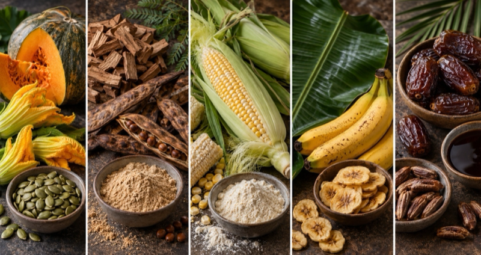

# Whole-Plant Ice Cream

*The photographs are AI-generated.*

## What it is

A print-ready cookbook of five ice creams. Each one is built from more than one part of the same plant: calabaza (fruit, flower, seed), mesquite (wood, pod), corn (cob, kernel, husk), banana (leaf, fruit), and date (seed, fruit). Parts you'd never eat on their own, like wood chips, a leaf, or a stripped cob, get steeped into the cream for the custard. The rest of the plant comes back as a syrup or caramel and a streusel or fruit pieces.

The book is typeset from code. Every word lives in a Python file, the layout is HTML and CSS, and a build script prints it to PDF through Chromium. It's on its fourth edition: a 21-page cookbook and a shorter Lite version.

## Why I made it

I was inspired by people making ice cream from trees. The steep-it-in-cream method comes from Justin Davies' tree ice creams for Milk Street. I developed the recipes with the help of AI.

## What was hard

Getting a browser to act like a typesetter. Each recipe gets exactly three pages, so the build script sizes every picture to fit its page and checks every page for overflow. A recipe that spills onto a fourth page breaks the whole plan.
